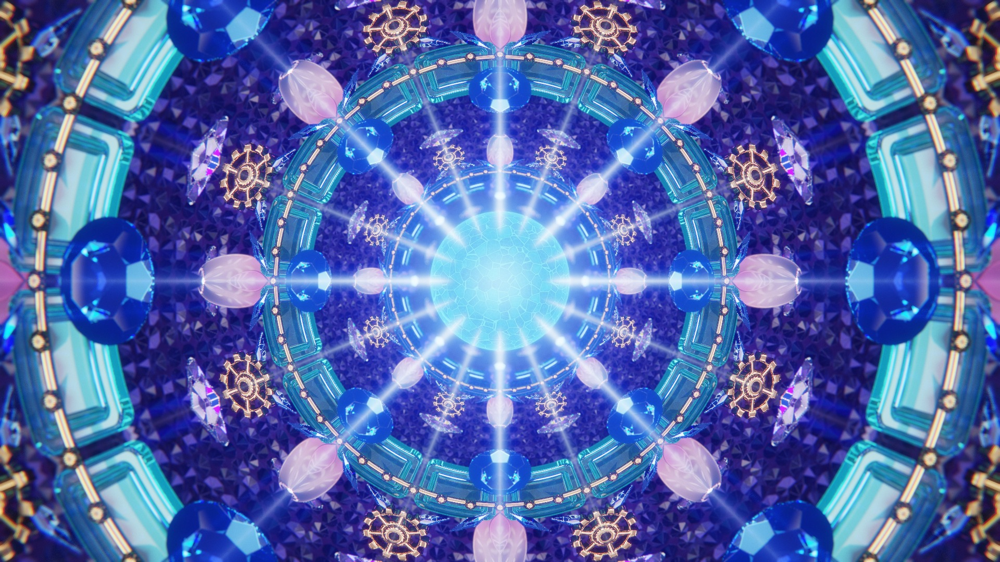
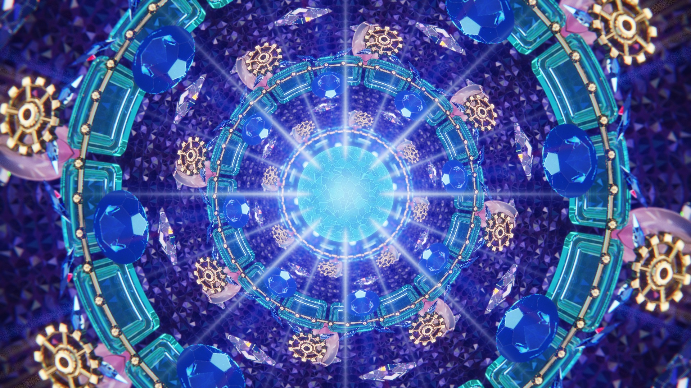
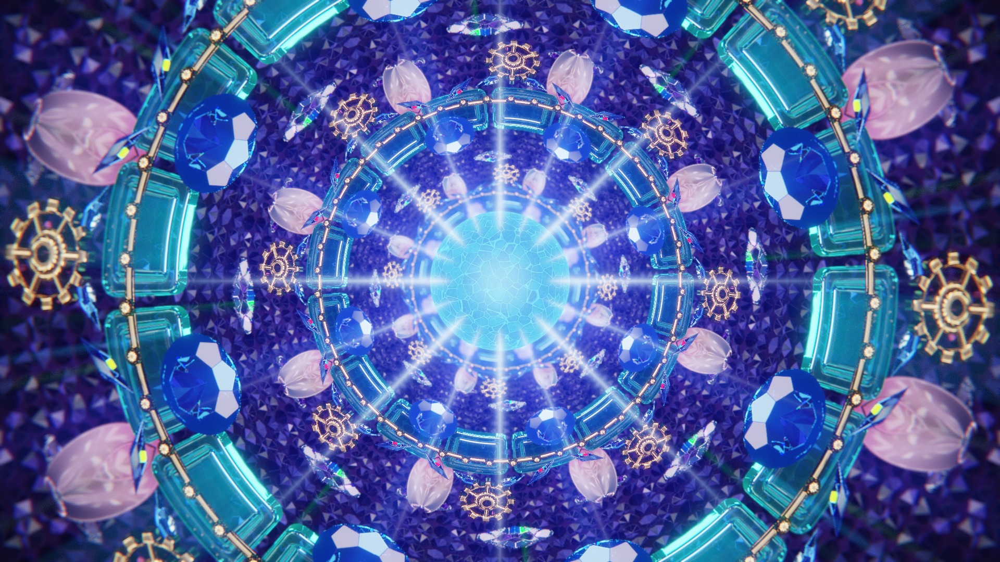
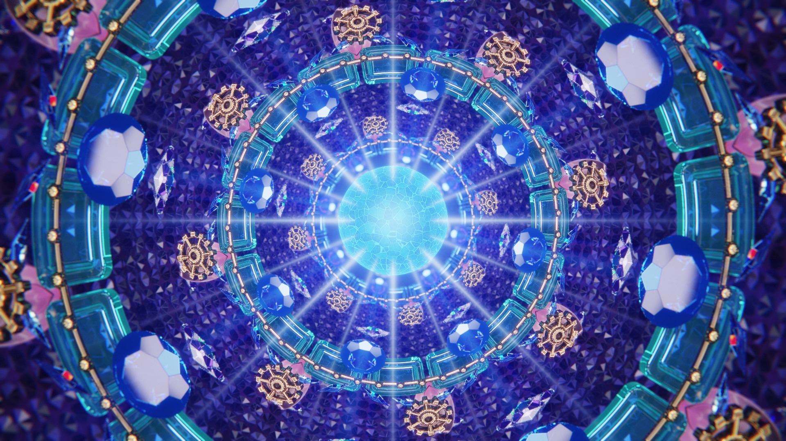
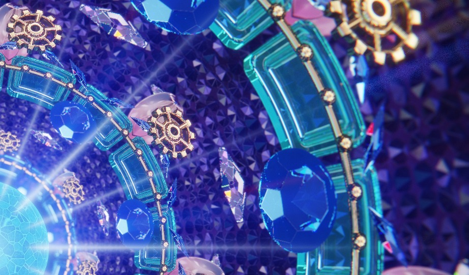

# Crystal Tunnel v2: a realtime GLSL kaleidoscope



An endless zoom into a glowing cellular core through counter-rotating rings of cut gems, refractive emerald glass, 3D silk petals and polished gold gears. It is rendered entirely in one fragment shader plus a post pass, with no meshes or textures, and it loops exactly every **40 seconds**.

**Live demo:** open `index.html`. It is a static page that works locally and on GitHub Pages. Press `H` to hide the UI, `F` for fullscreen and `Space` to pause. Use `?q=high` for the high-quality preset.

| | |
|---|---|
|  |  |
|  |  |

## What's in it
- **Raymarched SDF scene** in a log-polar, conformal warped space. It has 8-fold rotational symmetry with mirroring, so there are 16 wedges.
- **Three depth layers** that overlap and occlude one another:
  - **Top layer (+1 sector/loop):** floating round-brilliant gems (crown and pavilion facets), **PBR gold gears** (12 teeth, 6 spokes with windows, fat bevels, a raised hub, a bore, GGX specular and scene reflections) and a beaded gold ring.
  - **Middle layer (−1 sector/loop):** thick bevelled glass panels with pillow lenses, a fan of **3D silk petals** and KIFS fractal crystal clusters.
    - Each petal is a thick SDF shell, not a sprite, with a cupped cross-section, a mid-rib crease, a curled tip and silk ripples.
    - Petal shading combines wrap diffuse, sheen, a thin-film tint, a subsurface-style rim and back-lit translucency.
  - **Deep layer:** an amethyst druse carpet over an emissive Kali-fractal floor.
- **Real refraction.** Rays enter glass and gems, march through the interior and exit with per-channel IOR (dispersion). They can take a total-internal-reflection bounce. They then **march the scene again**, so the glass shows the neighbouring gears, petals and crystals behind it. Glass and gold also reflect neighbouring geometry.
- **Lighting:**
  - A procedural studio-dome environment with strip lights, softboxes and a ring light.
  - A cyan core light with soft shadows and SDF ambient occlusion.
  - Fake projected caustics from the gem layer.
  - Volumetric haze toward the core.
- **Post (Image pass):**
  - **Depth of field.** The scene writes a circle of confusion to alpha, and a 28-tap golden-angle gather with scatter-as-gather weighting produces the bokeh.
  - **Volumetric god rays.** A 56-step radial march from the core over the HDR mip chain.
  - A 7-level HDR bloom pyramid.
  - Radial chromatic aberration.
  - ACES filmic tonemapping.
  - Vignette.
  - Film grain that loops with the animation.
- **Anti-aliasing:**
  - N×N rotated-grid supersampling (AA 2 or 3), with each sample jittered across a 180° shutter for motion blur.
  - The druse carpet is **band-limited by pixel footprint**: crystal amplitude fades out before a cell gets near pixel size, which removes shimmer.
  - The Kali floor drops high-frequency iterations by footprint, and environment reflections are pre-filtered by footprint.
  - Normal and hit epsilons scale with the footprint.

## Run
```bash
# any static server (or just double-click index.html; the shaders are inlined)
python3 -m http.server 8000   # → http://localhost:8000/?q=high
```
Quality presets:
- **low** (default): half resolution, 1 spp. Shadow marches, secondary refraction marches and reflection marches are disabled with `#define LOWQ`.
- **high:** full resolution, 2×2 spp, every effect on. It needs a strong desktop GPU.

**Shadertoy:** paste `shaders/buffer_a.glsl` into **Buffer A** and `shaders/image.glsl` into **Image**. Set Image's iChannel0 to Buffer A with filter `mipmap` and wrap `clamp`.

**Edit:** change `shaders/*.glsl`, then run `python3 tools/build.py` to regenerate `index.html` (the shaders are inlined), and `python3 tools/check_es.py` to compile both shaders as GLSL ES 3.00 (WebGL2) through Mesa.

## Offline render pipeline
`tools/render.py` runs the **same GLSL** headless on the CPU (Mesa llvmpipe through EGL, with moderngl), so no GPU is needed:
```bash
pip install moderngl numpy opencv-python        # + ffmpeg on PATH
python3 tools/render.py still --w 854 --h 480 --aa 2 --t 0 10 20 --out work/st
# full loop, resumable, detached (survives logout); log in render.log
setsid nohup nice -n 5 tools/render_loop.sh 1920 1080 60 3 crf:16 > render.log 2>&1 < /dev/null &
```
`render_loop.sh` takes the arguments W H FPS AA RATE. It renders a PNG sequence (finished frames are skipped on re-run), encodes H.264 tagged BT.709 with faststart, and runs `tools/seam_check.py`.

`tools/seam_check.py` compares the last→first frame step against the normal consecutive-frame steps and builds a 3 s clip around the wrap.

Cost on an 8-core shared CPU box: 720p AA2 takes about 2–4 s/frame, and 1080p AA3 about 8 s/frame (a 1080p60 loop is about 5 h). On a GPU it runs in real time at the low preset.

## Loop math (exact)
- `phase = fract(t / 40)`.
- Screen point → warped space: `s = log(r)/SC − phase·NZOOM·P`, `v = fold(angle)`, `z = height`, with `SC = 0.72`, `P = 1` and `NZOOM = 4`.
- All geometry is periodic in `s` with period `P`, so after one loop the content has moved exactly 4 periods. The total zoom per loop is `e^(SC·P·NZOOM) = e^2.88 ≈ 17.8×`.
- Layers rotate by an **integer number of sectors** per loop (`±2π/8 · phase`). That is invisible at the wrap because of the 8-fold symmetry.
- Every other time term uses an integer multiple of `2π·phase`: light sweep, Kali constant, Voronoi core seeds, core spin, pulse, flare and grain seed.
- The palette drift depends on `phase + s/(4P)`, which is invariant at the wrap.
- Video frames are `t = f/fps` for `f = 0…N−1`, so frame N would equal frame 0.
- **Verified:** rendering t = 40 against t = 0 at 720p AA3 gives a mean abs diff of 0.03/255, and 95% of pixels are bit-identical (the rest are float rounding on fold edges). See `HANDOFF.md` for the encoded-video seam metric.

## Files
```
index.html               live WebGL2 demo (generated by tools/build.py; shaders inlined)
shaders/buffer_a.glsl    scene pass, Shadertoy Buffer A (rgb = linear HDR, a = CoC)
shaders/image.glsl       post pass, Shadertoy Image (iChannel0 = Buffer A, mipmap)
tools/                   build.py, check_es.py, render.py, render_loop.sh, seam_check.py, index.template.html
media/                   hero stills + preview video
HANDOFF.md               state, known issues, next steps (written as a GitHub issue)
```

## Credits
Design and direction by Jennipher Troup. It is inspired by AI-video kaleidoscope references (crystal tunnels, sapphire rings, gold gears). Every pixel here is procedural. Released under the MIT license.
